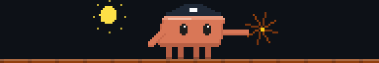
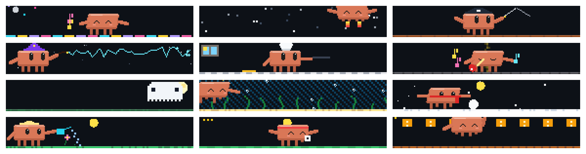

# claude-mods

Des mods fun pour [Claude Code](https://claude.com/claude-code) · 🇬🇧 [English version](README.md)

## 🎭 mascotte-du-jour

Une mascotte Claude animée en pixel art, qui vit au-dessus de ta zone de saisie. **Chaque jour, Claude choisit lui-même son thème** (pirate, espace, magicien, Halloween…) et une petite phrase sur son humeur : c'est sa façon de s'exprimer.



### Fonctionnalités

- **12 thèmes**, chacun avec une pose d'attente et 5 animations : Danse, Espace, Pirate, Magicien, Cuisine, Musique, Halloween, Océan, Hiver, Jardin, Sport, Arcade.
- **Elle réagit à ce que fait Claude** : elle lit un livre quand Claude lit des fichiers, tape sur un portable quand il modifie du code, regarde un terminal pendant les commandes, fait tourner un globe pendant les recherches web, envoie des mini-clones quand des sous-agents partent, et a l'air déçue après plusieurs erreurs.
- **Une petite fête** (confettis et un son rétro en option) à la fin des tours de plus de 2 minutes.
- **Ligne de suivi** : `▶ écrit du code · 6 min · 23 actions`.
- **Le ciel suit l'heure** : soleil levant, soleil couchant, puis la lune et les étoiles la nuit.
- **Dates spéciales** avec des animations exclusives : Halloween, Noël, Nouvel An, Chandeleur, Saint-Valentin, 1er avril, Fête de la musique.
- **Pixel art HD** sur les grands terminaux : la scène est dessinée jusqu'à deux fois plus finement (formes arrondies, yeux brillants, pluie fine…).
- Fonctionne dans le terminal et dans l'onglet **Code** de Claude Desktop (SVG animé).
- En français et en anglais.



### Installation

Dans Claude Code :

```
/plugin marketplace add arseum/claude-mods
/plugin install mascotte-du-jour@claude-mods
```

Puis redémarre Claude Code.

### Utilisation

| Commande | Effet |
| --- | --- |
| `/mascotte` | Affiche le thème du jour et la phrase de Claude |
| `/mascotte <thème>` | Impose un thème pour aujourd'hui (`/mascotte pirate`) |
| `/mascotte rechoisir` | Laisse Claude choisir à nouveau |
| `/mascotte son on` · `son off` | Joue un petit son à la fin des longs tours (coupé par défaut) |
| `/mascotte diag` | Diagnostic : taille de la bande, rendu, animation en cours |

En anglais, la commande s'appelle `/mascot` (`reroll`, `sound on|off`).

**Langue** : l'option `language` (`auto`, `fr`, `en`) est dans `/config`. `auto` suit la langue réglée dans Claude Code.

**Taille** : la mascotte s'adapte à la place disponible au-dessus du prompt : 5, 8, 10, 12 ou 16 lignes. Le rendu HD commence à 10 lignes ; la HD complète demande environ 45 lignes de terminal.

### Bon à savoir

- **Coût** : une fois par jour, le mod fait un petit appel à Claude (Opus, effort faible) pour choisir le thème. Sans réponse, il tire un thème au sort.
- **Compatibilité** : c'est un *mod* (un plugin de hooks en fonctions) : il faut une version récente de Claude Code qui gère les mods. Développé et testé sur Claude Code 2.1.287.
- Plusieurs sessions ouvertes partagent le même thème du jour.

### Développement

```
claude plugin validate plugins/mascotte-du-jour
claude plugin test plugins/mascotte-du-jour
```

Pour essayer tes modifications en local, charge le dossier avec `claude --plugin-dir plugins/mascotte-du-jour`.

### Licence

[MIT](LICENSE) © amaitre

*Projet communautaire, sans lien avec Anthropic. Le petit personnage orange est un hommage de fan à Claude Code.*
